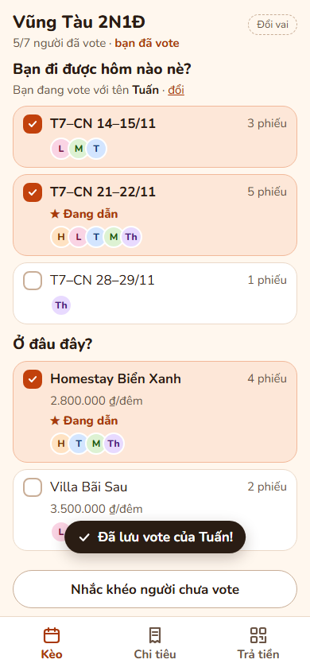
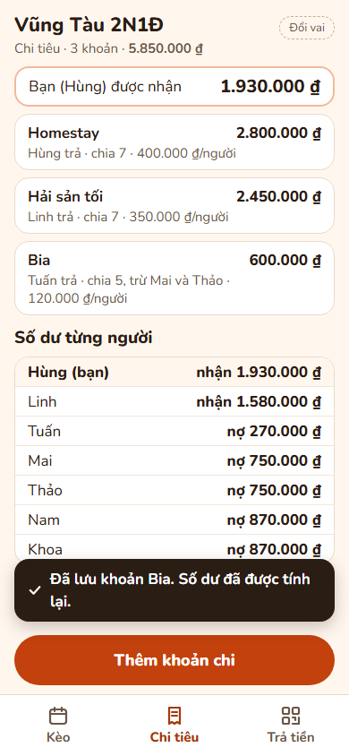
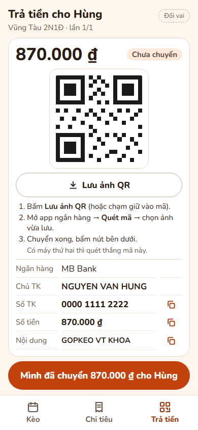
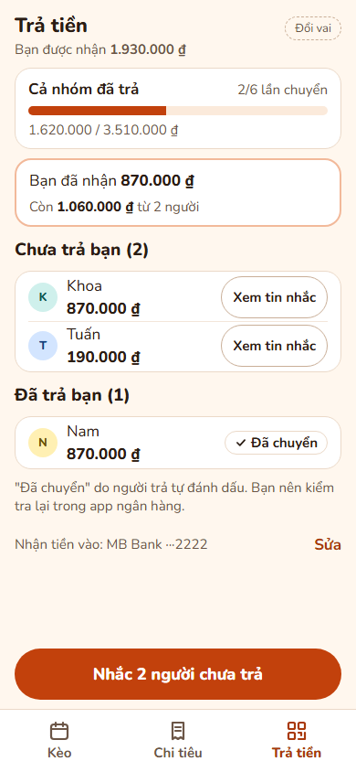

# Góp Kèo

**Lên kèo đi chơi và chia tiền cho nhóm bạn, chỉ bằng một đường link gửi vào Zalo.**
Cả nhóm vote ngày và chỗ để chốt kèo, ghi lại ai đã trả khoản gì, rồi mỗi người nhận một mã VietQR
có sẵn đúng số tiền mình nợ. Không cần cài app, không cần đăng ký.

> *A mobile web app for Vietnamese friend groups: vote on trip dates and places, log shared expenses,
> and settle up with pre-filled VietQR bank-transfer codes — all from one link shared in Zalo.
> No install, no sign-up. Built step by step with Claude Code, from problem brief to tested slices.*

| Vote ngày và chỗ | Bảng chi tiêu | Trả bằng VietQR | Ai chưa trả |
|---|---|---|---|
|  |  |  |  |

*Ảnh từ prototype (dữ liệu giả). App thật đang được xây dựng.*

## Vì sao có app này
Nhóm 7 người rủ nhau đi Vũng Tàu qua Zalo: 9 ngày và khoảng 200 tin nhắn mới chốt được, bình chọn bị trôi,
3 người cùng ứng tiền, chia sai tiền bia phải tính lại, và 3 tuần sau vẫn còn người chưa trả.
Chỗ đau nhất là **đòi tiền và tính lại khi sai**, vì nó đụng đến tình cảm. Chi tiết ở [problem brief](docs/00-brief.md).

## Làm được gì (v1)
- **Chốt kèo:** vote nhiều ngày, nhiều chỗ bằng 1–2 chạm; thấy ai chưa vote; người tạo chốt và thẻ tóm tắt ghim đầu trang.
- **Chi tiêu minh bạch:** nhiều người cùng ứng tiền; mỗi khoản ghi ai trả, chia cho ai; sửa một khoản thì số dư tự tính lại,
  người bị ảnh hưởng thấy rõ trước/sau.
- **Trả bằng VietQR:** app gộp nợ để mỗi người chuyển ít lần nhất; mã QR điền sẵn số tài khoản, số tiền, nội dung;
  người được nợ thấy ai đã trả và copy tin nhắc soạn sẵn để dán vào Zalo.
- **Không làm:** không giữ tiền, không đối soát ngân hàng, không chat, không đăng ký tài khoản.

## Công nghệ
Next.js (App Router, TypeScript) · Tailwind CSS · Supabase (Postgres, RLS) · Vercel.
Mọi truy cập dữ liệu đi qua server; mã QR tạo ngay trên máy theo chuẩn VietQR (EMVCo/Napas), không gửi số tài khoản
cho bên thứ ba. Xem [kiến trúc](docs/02-architecture.md).

## Cách dự án được xây dựng
Dự án đi theo một quy trình từng bước ([PLAYBOOK](docs/PLAYBOOK.md)), Claude Code vừa hướng dẫn vừa thực thi,
chủ dự án duyệt ở mỗi cổng (GATE):

1. **Brief** — vấn đề, persona, 3 việc bắt buộc, non-goals, chỉ số thành công: [docs/00-brief.md](docs/00-brief.md)
2. **Thiết kế** — flow, wireframe, 3 hướng giao diện, prototype, đánh giá chuyên gia, tokens:
   [docs/design/](docs/design/) ([màn hình đã chốt](docs/design/screens/README.md), [quyết định](docs/design/decisions.md),
   [tokens](docs/design/tokens.md))
3. **Đặc tả** — [PRD](docs/01-prd.md), [kiến trúc](docs/02-architecture.md), [schema SQL](docs/03-schema.sql),
   [contracts](docs/04-contracts.md), [test plan](docs/05-test-plan.md), [tiêu chí nghiệm thu](docs/06-acceptance.md)
4. **Kế hoạch slice** — từng lát cắt dọc có test trước, file được/cấm sửa, tiêu chí xong: [docs/plans/](docs/plans/README.md)
5. **Code theo slice** → QA → bug bash với người thật → ra mắt (đang làm)

## Trạng thái
Đang ở **Bước 9 — thiết lập repo** (khung Next.js, công cụ kiểm tra, cấu hình Claude Code). Chưa có tính năng chạy được.
Tiến độ chi tiết: [docs/STATUS.md](docs/STATUS.md).

## Chạy thử (cho người phát triển)
```bash
npm install
npm run dev
npm run check
```
Cần Node 22. Biến môi trường xem `.env.example` (có từ slice 00); không bao giờ commit file `.env*`.

## Giấy phép
[MIT](LICENSE)
